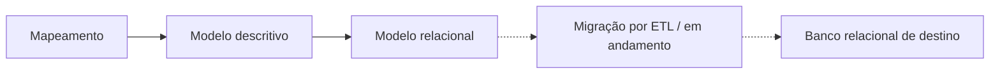

# Modelagem e migração de dados de um fundo de endowment

Atuação em um projeto de engenharia de dados voltado ao mapeamento das informações, à elaboração de modelos de dados e à migração para um banco relacional.

| Aspecto | Descrição |
| --- | --- |
| Contexto | Projeto desenvolvido em equipe na Fluxo Consultoria para um fundo de endowment. |
| Atuação | Mapeamento dos dados e elaboração dos modelos descritivo e relacional, com participação na fase de migração. |
| Etapas realizadas | Mapeamento e criação dos modelos descritivo e relacional. |
| Fase atual | Início da etapa de migração por ETL em arquitetura medalhão. |

## Contexto e objetivo

O projeto envolve a organização dos dados de um fundo de endowment, começando pelo mapeamento das informações e pela criação dos modelos descritivo e relacional.

Essa estruturação prepara a migração dos dados para um banco relacional. A fase atual concentra-se na entrada na etapa de ETL, organizada segundo uma arquitetura medalhão.

## Minha contribuição

Atuei em equipe no:

- Mapeamento das informações abrangidas pelo projeto.
- Elaboração do **modelo descritivo**.
- Construção do **modelo relacional**.
- Trabalho de organização dos dados para apoiar a migração.

Também participo da nova fase, voltada à migração para o banco relacional por meio de ETL. Essa etapa está em andamento.

## Etapas do trabalho

### 1. Mapeamento dos dados

Levantamento e organização das informações para fundamentar o trabalho de modelagem.

### 2. Modelo descritivo

Criação do modelo descritivo como parte da documentação dos dados abrangidos pelo projeto.

### 3. Modelo relacional

Elaboração do modelo relacional que orienta a organização dos dados no banco de destino.

### 4. Migração e ETL — em andamento

Entrada na fase de extração, transformação e carga para o banco relacional, utilizando uma arquitetura medalhão.

## Visão do processo

O diagrama representa as etapas gerais do projeto. As setas pontilhadas identificam a fase em andamento.

A arquitetura medalhão faz parte da abordagem da migração. O detalhamento das camadas, transformações e mecanismos de validação será incorporado à documentação conforme essa fase avançar.

## Principais desafios

**Compreensão dos dados antes da migração.** O trabalho começou pelo mapeamento, que fornece a base para a organização dos modelos e para a preparação da migração.

**Articulação entre documentação e estrutura relacional.** Os modelos descritivo e relacional são entregas complementares: documentam as informações do projeto e orientam sua representação no banco de destino.

**Transição da modelagem para o ETL.** A fase atual amplia o trabalho para a implementação da migração. Seus resultados serão apresentados conforme as entregas forem realizadas.

## Entregas e estágio atual

| Etapa | Situação |
| --- | --- |
| Mapeamento dos dados | Realizado. |
| Modelo descritivo | Elaborado. |
| Modelo relacional | Elaborado. |
| Migração por ETL | Fase inicial, em andamento. |

## Competências desenvolvidas

Mapeamento e documentação de dados, modelagem descritiva e relacional, trabalho colaborativo e participação em um projeto de migração estruturado por ETL.

---

[Voltar ao índice](./README.md) · [Caso anterior: software científico](./software-cientifico.md)
