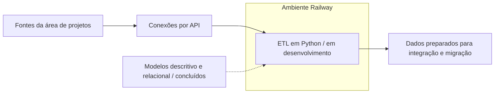

# Modelagem e ETL de dados de um fundo de endowment

Atuação em equipe no mapeamento, na documentação e na modelagem de dados de um fundo patrimonial. O escopo atual concentra-se na área de projetos, com modelos concluídos e ETL em desenvolvimento utilizando Python, APIs e Railway.

| Aspecto | Descrição |
| --- | --- |
| Contexto | Projeto desenvolvido na Fluxo Consultoria para um fundo de endowment. |
| Escopo atual | Integração e migração dos dados da área de projetos. |
| Entregas concluídas | Modelos descritivo e relacional da área de projetos. |
| Fase atual | Desenvolvimento do ETL com scripts Python e conexões por API, em ambiente Railway. |
| Sistema complementar | Visualização e inserção de dados em aprovação; Airtable em discussão. |

## 1. Contexto e objetivo

A organização mantinha informações distribuídas entre áreas, programas e ferramentas. Os levantamentos identificaram necessidades de integração, compartilhamento entre equipes e preservação do histórico.

O trabalho partiu do mapeamento dessas informações e da tradução dos processos em requisitos e modelos de dados. Com a evolução do projeto, o foco passou a se concentrar na **área de projetos**.

Os modelos descritivo e relacional desse recorte foram concluídos. A equipe está desenvolvendo o ETL para integrar as fontes e realizar a migração dos dados.

## 2. Minha contribuição

Atuei em equipe no:

- Mapeamento das informações e dos processos abrangidos pelo projeto.
- Elaboração do **modelo descritivo**.
- Construção e revisão do **modelo relacional**.
- Trabalho de organização dos dados para apoiar sua integração e migração.

Também participo da fase atual de ETL, desenvolvida com **scripts Python e conexões por API em ambiente Railway**.

O trabalho reúne entendimento dos processos, documentação das regras e estruturação dos dados para orientar a implementação da integração.

## 3. Solução e fluxo de dados

A solução conecta o levantamento dos processos, os modelos e o desenvolvimento das rotinas de ETL.

### Modelos descritivo e relacional

O modelo descritivo reúne o contexto, as necessidades de informação, as histórias de usuário e as regras de negócio. O modelo relacional especifica entidades, atributos, chaves e relacionamentos que orientam a organização dos dados.

Os materiais do levantamento também distinguem processos atuais (**AS-IS**) de propostas de funcionamento (**TO-BE**). Essa separação ajuda a relacionar a operação existente aos requisitos de evolução.

No escopo atual, os dois modelos da área de projetos estão concluídos e servem de referência para o ETL.

### ETL em desenvolvimento

A fase atual utiliza **Python** e **conexões por API**, com o processo sendo desenvolvido em ambiente **Railway**.

O diagrama apresenta o fluxo conceitual do trabalho em desenvolvimento. As etapas específicas de transformação, persistência e validação serão detalhadas conforme a implementação avançar.

### Visualização e inserção de dados

Há uma frente complementar para disponibilizar a visualização e a inserção de dados. Esse sistema está em aprovação pela equipe da organização.

O **Airtable** é uma opção em discussão para essa finalidade. A redação distingue essa proposta da infraestrutura já utilizada no desenvolvimento do ETL.

| Tecnologia ou componente | Papel e estágio |
| --- | --- |
| Python | Scripts do ETL em desenvolvimento. |
| APIs | Conexões utilizadas no processo de integração dos dados. |
| Railway | Ambiente utilizado no desenvolvimento do processo de ETL. |
| Airtable | Opção em discussão para o sistema complementar de visualização e inserção. |

## 4. Desafios e decisões de modelagem

O levantamento inicial identificou desafios de integração decorrentes da distribuição das informações entre áreas e ferramentas.

Entre os temas tratados nos modelos e nas revisões estão:

- Separação entre a identidade de uma pessoa e seus diferentes papéis e participações.
- Representação das informações no contexto de ciclos ou edições.
- Preservação do histórico de vínculos e mudanças de situação.
- Reutilização de dados compartilhados entre processos.
- Compatibilização de formulários e necessidades específicas das áreas.

Esses temas pertencem ao trabalho de levantamento e modelagem. O recorte atual da área de projetos orienta a implementação das rotinas de integração e migração.

## 5. Qualidade e verificação

A modelagem passou por revisões técnicas e feedbacks de representantes das áreas, com ajustes documentados nas propostas.

Os materiais registram a especificação de:

- Entidades, atributos e relacionamentos.
- Chaves, cardinalidades, obrigatoriedade e unicidade.
- Regras de negócio e responsabilidades.
- Necessidades de histórico e de integração entre processos.

As verificações da documentação e dos modelos são distintas das verificações das cargas. Os procedimentos e resultados de validação do ETL serão registrados conforme essa fase avançar.

## 6. Entregas e estágio atual

| Entrega ou frente | Situação |
| --- | --- |
| Mapeamento e documentação dos processos | Realizados, com materiais e revisões registrados. |
| Modelo descritivo da área de projetos | Concluído. |
| Modelo relacional da área de projetos | Concluído. |
| ETL com Python e APIs em ambiente Railway | Em desenvolvimento. |
| Sistema de visualização e inserção de dados | Em aprovação. |
| Uso do Airtable nesse sistema | Em discussão. |

A conclusão dos modelos da área de projetos permitiu avançar do entendimento e da estruturação das informações para o desenvolvimento do ETL.

## 7. Escopo e evolução

A implementação da integração e da migração está em andamento. Esta versão apresenta a modelagem concluída, as tecnologias confirmadas da nova fase e a proposta do sistema complementar.

Os detalhes do banco de destino, das transformações, das cargas e das validações serão incorporados à documentação a partir das definições e entregas dessa fase.

## 8. Competências desenvolvidas

Mapeamento de processos e informações, levantamento de requisitos, documentação de regras de negócio, modelagem relacional, representação de histórico e trabalho colaborativo em integração de dados. A fase atual amplia a atuação para ETL com Python e APIs em ambiente Railway.

---

[Voltar ao índice](./README.md) · [Caso anterior: software científico](./software-cientifico.md)
