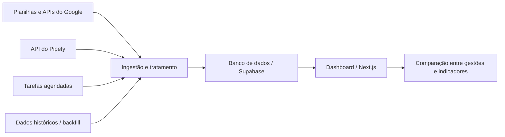

# Dashboard de inteligência comercial

Desenvolvimento de uma aplicação interna para consolidar dados históricos e apoiar análises comparativas do setor comercial da Fluxo Consultoria.

| Aspecto | Descrição |
| --- | --- |
| Contexto | Projeto interno da Fluxo Consultoria. |
| Atuação | Desenvolvimento individual, desde a identificação da necessidade até a implementação da solução. |
| Tecnologias | Next.js, Supabase, APIs do Google e do Pipefy e tarefas agendadas. |
| Áreas envolvidas | Comercial e Marketing. |

## Contexto e problema

As áreas Comercial e Marketing precisavam cruzar informações de diferentes gestões para analisar metas, vendedores, funil comercial e outras métricas da operação.

A construção dessas análises exigia reunir dados históricos, tratar as informações e conectar fontes utilizadas pela empresa. O desafio envolvia tanto a integração e a organização dos dados quanto sua apresentação em uma interface que permitisse comparações.

## Minha contribuição

Identifiquei a necessidade interna e desenvolvi a solução de forma independente. Minha atuação incluiu:

- Desenvolvimento da aplicação e do dashboard interativo com **Next.js**.
- Integração com APIs do **Google** e do **Pipefy**.
- Implementação de tarefas agendadas para leitura automatizada de planilhas.
- Ingestão, análise e tratamento de dados de diferentes gestões.
- Realização de **backfill** para incorporar informações históricas ao banco.
- Uso do **Supabase** para a persistência dos dados utilizados pela aplicação.
- Construção das visualizações e dos recursos de comparação de indicadores comerciais.

Parte do trabalho exigiu aprender ferramentas com as quais eu ainda não tinha familiaridade, especialmente as integrações com APIs, a execução de rotinas agendadas e o carregamento histórico de dados.

## Visão da solução

O fluxo conceitual combina coleta, tratamento, armazenamento e consulta das informações.

O diagrama apresenta o fluxo de informação em alto nível, sem detalhar a implementação dos conectores ou a estrutura interna do banco.

## Componentes e finalidade

| Componente | Finalidade no projeto |
| --- | --- |
| Integrações com APIs | Obter informações das ferramentas utilizadas na operação comercial. |
| Rotinas agendadas | Automatizar a leitura de planilhas. |
| Tratamento de dados | Preparar as informações para sua utilização nas análises. |
| Backfill | Incorporar registros históricos e viabilizar comparações entre gestões. |
| Banco de dados | Persistir as informações utilizadas pela aplicação. |
| Dashboard interativo | Permitir a exploração de metas, vendedores, funil e outras métricas. |

## Principais desafios

**Integração de informações históricas.** A análise entre gestões exigiu trabalhar com dados de períodos diferentes, articulando ingestão, tratamento e carregamento histórico.

**Conexão entre dados e interface.** A aplicação precisava apresentar os dados de uma forma útil para a área comercial. O trabalho envolveu a construção do fluxo de dados e dos recursos de análise no dashboard.

**Aprendizado durante a implementação.** As APIs e as rotinas de automação ampliaram o escopo técnico do projeto e exigiram o estudo de ferramentas novas durante o desenvolvimento.

## Entregas realizadas

- Dashboard interativo para análise de indicadores comerciais.
- Integrações com fontes utilizadas pela empresa.
- Rotinas de leitura automatizada de planilhas.
- Tratamento e incorporação de dados históricos.
- Recursos de comparação entre diferentes gestões.

## Competências desenvolvidas

Desenvolvimento fullstack, integração de APIs, automação de rotinas, ingestão e tratamento de dados, backfill e tradução de necessidades de negócio em funcionalidades de software.

---

[Voltar ao índice](./README.md) · [Próximo caso: software científico](./software-cientifico.md)
