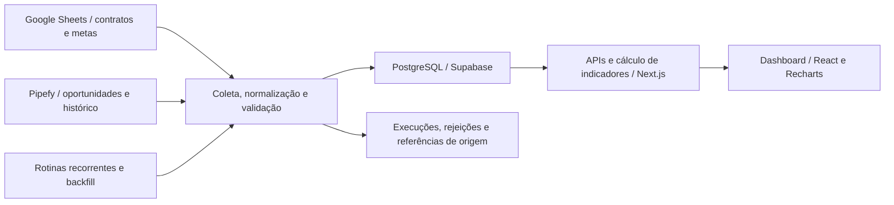

# Dashboard de inteligência comercial

Desenvolvimento individual de uma aplicação fullstack de inteligência comercial, em uso por todas as lideranças da Fluxo Consultoria, com atualização automática, centralização de dados e alertas de informações incompletas e inconsistências.

| Aspecto | Descrição |
| --- | --- |
| Contexto | Projeto interno da Fluxo Consultoria. |
| Atuação | Desenvolvimento individual, desde a identificação da necessidade até a implementação da solução. |
| Tecnologias principais | Next.js, React, TypeScript, Supabase/PostgreSQL, Google Sheets API e Pipefy GraphQL. |
| Áreas envolvidas | Comercial e Marketing. |
| Uso atual | Todas as lideranças da empresa. |
| Atualização | Automática, em operação. |

## 1. Contexto e objetivo

As áreas Comercial e Marketing precisavam cruzar informações de diferentes gestões para analisar vendas, metas, vendedores e movimentações do funil. Os dados estavam distribuídos entre planilhas de contratos e metas e o CRM comercial.

O objetivo foi construir uma aplicação que reunisse essas fontes em uma base centralizada, oferecesse recursos de comparação e permitisse conferir os registros que compõem os indicadores. Isso exigiu trabalhar com diferenças de formato, calendários de gestão, disponibilidade de histórico e regras de cálculo.

## 2. Minha contribuição

Identifiquei a necessidade interna e desenvolvi a solução de forma independente. Minha atuação incluiu:

- Desenvolvimento do frontend, dos gráficos, dos filtros e das APIs de consulta com **Next.js, React e TypeScript**.
- Integração com a **Google Sheets API** e a API **GraphQL do Pipefy**.
- Modelagem e evolução da persistência em **PostgreSQL no Supabase**.
- Implementação das rotinas de ingestão, normalização, validação, atualização e **backfill**.
- Construção dos cálculos comerciais e das comparações entre períodos e etapas do funil.
- Implementação de registros de execução, rejeições, referências de origem e snapshots de métricas.
- Desenvolvimento de testes de lógica, scripts de auditoria e configurações de agendamento.

O trabalho também envolveu o aprendizado de ferramentas com as quais eu ainda não tinha familiaridade, especialmente as integrações com APIs, as rotinas agendadas e o carregamento histórico de dados.

## 3. Solução, arquitetura e fluxo de dados

As planilhas fornecem contratos e metas; o CRM fornece oportunidades e histórico de etapas. Essas fontes alimentam conjuntos distintos de indicadores na mesma aplicação. A solução não depende de um vínculo individual entre cada contrato da planilha e uma oportunidade do CRM.

O diagrama representa o fluxo funcional em alto nível, sem detalhar a topologia de implantação.

### Ingestão e atualização

As rotinas tratam diferenças de cabeçalhos e formatos, validam campos obrigatórios e registram rejeições com motivo e referência à fonte. A persistência utiliza **upsert**, atualização de vínculos e reconciliação de registros removidos das fontes.

No CRM, a leitura é paginada e compara os horários de atualização para evitar regravações de cards sem alteração. O backfill reutiliza a lógica de ingestão para processar fontes históricas e permitir reprocessamentos.

A atualização automática está em operação. O projeto também inclui atualização manual pela interface, configurações de **pg_cron e pg_net** no banco e um workflow de **GitHub Actions** previsto como reserva.

### Consulta e análise

A aplicação oferece filtros por gestão, ciclo e mês, comparações em períodos equivalentes, rankings de vendedores, distribuição por canal e análises de conversão e tempo no funil. Há comparadores entre etapas e entre coortes de oportunidades criadas em períodos diferentes.

Os calendários e mapeamentos por fonte orientam essas consultas, incluindo gestões com ciclos de durações diferentes e mudanças na estrutura do CRM.

## 4. Desafios e decisões técnicas

O maior desafio foi compatibilizar os diferentes recortes temporais e setoriais da empresa em dados provenientes de fontes distintas. As regras de gestão, ciclo, mês e coordenação precisaram ser articuladas nos processos de tratamento, consulta e cálculo dos indicadores.

| Desafio | Abordagem implementada |
| --- | --- |
| Planilhas com formatos e nomenclaturas diferentes | Cadastro de fontes por gestão, normalização de cabeçalhos e leitura específica dos blocos de metas. |
| Calendários, ciclos e recortes por coordenação diferentes entre gestões | Centralização das definições de período e aplicação dos filtros temporais e setoriais nas análises e comparadores. |
| Mudanças nas etapas do CRM e histórico incompleto | Mapeamento por pipe, identificação de etapas não instrumentadas e inferência de progressão para determinados cálculos de conversão. |
| Contratos homônimos e limites de consulta | Evolução da chave de identificação dos contratos e paginação com ordenação estável nas leituras principais. |
| Necessidade de conferir os números apresentados | Registro da procedência, auditoria entre fontes e banco e detalhamento dos registros que compõem os indicadores. |
| Alterações retroativas em períodos já analisados | Snapshots por período e versão de cálculo, com hash e comparação com o recálculo da base atual. |

## 5. Qualidade e verificação

O projeto inclui testes de lógica com **Vitest** para parsers, calendários, filtros, conversões, identidade dos contratos e snapshots, entre outras regras.

Os mecanismos de conferência incluem:

- Registro das execuções de ingestão, com situação, horários e contagens.
- Registro de rejeições e referências às fontes.
- Alertas de dados incompletos e inconsistências na auditoria.
- Auditoria de presença ou ausência de contratos entre planilhas e banco.
- Verificação de identidades repetidas, vínculos e procedência dos registros.
- Conferência das quantidades lidas, aceitas, rejeitadas e ignoradas.
- Indicação da idade dos dados a partir da última carga bem-sucedida.
- Comparação entre snapshots e recálculos dos indicadores.

Esses itens descrevem mecanismos presentes na implementação. A versão atual da suíte não foi executada para a preparação deste estudo.

## 6. Entregas e resultados

A aplicação está em uso por **todas as lideranças da empresa**. O principal resultado foi a **centralização das informações comerciais no banco de dados**, reunindo fontes utilizadas nas análises de diferentes gestões e áreas.

A **auditoria de dados** é um dos recursos de destaque: os alertas de informações incompletas e inconsistências apoiam a conferência dos dados utilizados nos indicadores.

As entregas incluem:

- Dashboard com indicadores comerciais, gráficos e detalhamento dos registros.
- Telas de vendedores, metas, funil e auditoria.
- Filtros temporais e comparadores entre etapas e períodos.
- Integrações com planilhas e CRM, rotinas de sincronização e ferramentas de backfill.
- Auditoria com alertas de qualidade, rastreabilidade, conferência e preservação de métricas por período.
- Exportação de gráficos com o contexto dos filtros e do período selecionado.

## 7. Escopo e limitações

A interpretação dos indicadores depende das regras de cada análise. O total vendido representa valores de contratos, sem equivaler necessariamente a recebimentos financeiros. Nos rankings, cada responsável pode receber o valor integral de um contrato; os totais individuais não são parcelas somáveis do total geral.

As comparações do funil consideram a cobertura e a instrumentação das fontes. Uma progressão inferida para cálculo de conversão não comprova que uma transição foi registrada nem permite atribuir a ela um horário observado.

Os snapshots preservam métricas consolidadas; o detalhamento de origem consulta a base atual. O cadastro de novas fontes, a correção das rejeições e o congelamento de períodos exigem intervenção deliberada.

## 8. Competências desenvolvidas

Desenvolvimento fullstack, integração REST e GraphQL, modelagem relacional, SQL, ingestão e tratamento de dados, backfill, regras de comparação temporal, rastreabilidade, auditoria e testes de lógica.

---

[Voltar ao índice](./README.md) · [Próximo caso: software científico](./software-cientifico.md)
