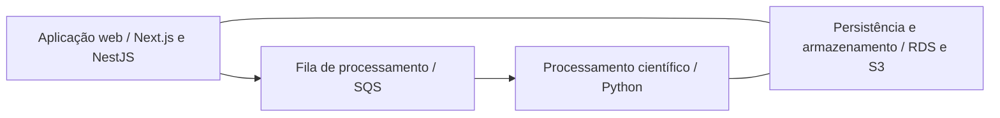

# Transformação de uma ferramenta científica em aplicação web

Atuação no desenvolvimento de uma aplicação web para uma ferramenta de análise preditiva de rochas, originalmente executada em ambiente local.

| Aspecto | Descrição |
| --- | --- |
| Contexto | Projeto desenvolvido em equipe na Fluxo Consultoria. |
| Atuação | Refatoração, desenvolvimento web, integração com o motor científico e implementação de requisitos de infraestrutura, processamento e acesso. |
| Software existente | Código Python com aproximadamente 5 mil linhas, reunindo interface gráfica e cálculos. |
| Tecnologias | Python, Next.js, NestJS, Docker Compose, Nginx e AWS — EC2, SQS, RDS e S3. |

## Contexto e problema

O serviço original era uma ferramenta local de análise preditiva de rochas, com cálculos geofísicos e redes neurais. O projeto tinha como objetivo disponibilizar esse serviço por meio de uma aplicação web.

O primeiro desafio estava na organização do software existente: um arquivo Python de aproximadamente **5 mil linhas**, com interface gráfica e lógica matemática misturadas. A transformação também exigia desenvolver a aplicação web e integrar o processamento científico a uma arquitetura com persistência, armazenamento e execução assíncrona.

O trabalho ocorreu em um contexto de alta complexidade e prazo reduzido.

## Minha contribuição

Atuei em equipe nas seguintes frentes:

- Refatoração do código Python existente, trabalhando na separação entre interface e lógica de cálculo.
- Desenvolvimento da aplicação web com **Next.js** e **NestJS**.
- Integração da aplicação com o motor científico existente.
- Trabalho na arquitetura com **EC2, SQS, RDS e S3**.
- Uso de **Docker Compose** e **Nginx** na infraestrutura da aplicação.
- Implementação de lógicas de fila e processamento assíncrono.
- Implementação de requisitos de auditoria, hierarquia de acesso e segurança, incluindo **MFA**.

A contribuição envolveu a transformação e a integração do software existente. O motor científico já fazia parte do serviço original.

## Visão da solução

A solução reúne a aplicação web, o processamento científico e os componentes de persistência e armazenamento.

O diagrama é uma visão funcional simplificada. **EC2, Docker Compose e Nginx** integram a infraestrutura utilizada; a representação não especifica a topologia de implantação, as rotas internas ou a disposição dos serviços.

## Componentes e finalidade

| Componente | Finalidade no projeto |
| --- | --- |
| Python | Refatoração e integração do processamento científico existente. |
| Next.js e NestJS | Desenvolvimento dos componentes da aplicação web. |
| SQS | Fila para o processamento assíncrono. |
| RDS | Persistência de dados em banco relacional. |
| S3 | Armazenamento de arquivos e dados utilizados pela solução. |
| EC2 | Infraestrutura computacional. |
| Docker Compose e Nginx | Componentes da infraestrutura da aplicação. |
| Auditoria, hierarquia de acesso e MFA | Requisitos de rastreabilidade, autorização e autenticação. |

## Principais desafios

**Refatoração de software existente.** A transformação começou pela organização de um código com responsabilidades de apresentação e cálculo concentradas em um único arquivo. Essa etapa foi parte da preparação para integrar o serviço à aplicação web.

**Integração entre componentes.** O projeto exigiu conectar interface, backend, processamento científico, fila, banco e armazenamento, articulando o serviço existente com os componentes desenvolvidos pela equipe.

**Processamento assíncrono.** A execução dos cálculos precisou ser integrada à lógica de filas da solução. Essa frente reuniu o processamento Python e a infraestrutura de execução.

**Auditoria e controle de acesso.** A aplicação incorporou requisitos de registro de ações, hierarquia de permissões e autenticação multifator, além do fluxo de análise científica.

## Escopo desenvolvido

- Refatoração do software Python original.
- Desenvolvimento dos componentes web e integração com o motor científico.
- Estruturação do processamento assíncrono e das integrações de persistência e armazenamento.
- Implementação de requisitos de auditoria, hierarquia de acesso e MFA.

## Competências desenvolvidas

Refatoração, desenvolvimento fullstack, integração de software científico, processamento assíncrono, infraestrutura de aplicações e implementação de requisitos de segurança e auditoria em um projeto colaborativo.

---

[Voltar ao índice](./README.md) · [Próximo caso: engenharia de dados](./engenharia-de-dados.md)
