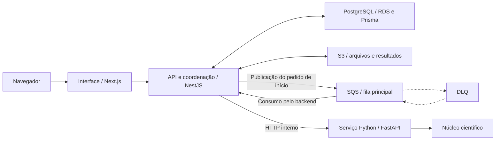

# Transformação de uma ferramenta científica em aplicação web

Atuação em equipe na modernização de uma ferramenta desktop de física de rochas probabilística, integrando seus fluxos científicos a uma aplicação web com gestão de projetos, arquivos, modelos e execuções.

| Aspecto | Descrição |
| --- | --- |
| Contexto | Projeto desenvolvido na Fluxo Consultoria para análise de dados de poços e propriedades de rochas. |
| Atuação | Refatoração, desenvolvimento fullstack, integração científica, processamento assíncrono, infraestrutura e controle de acesso. |
| Software preexistente | Ferramenta Python com aproximadamente 5 mil linhas, reunindo interface gráfica, preparação de dados e cálculos. |
| Tecnologias principais | Next.js, NestJS, Python/FastAPI, Prisma/PostgreSQL, Docker Compose, Nginx e AWS. |
| Escopo técnico registrado | Cinco fases científicas implementadas, com registros de execução integrada. |
| Situação atual | Aplicação em funcionamento, com correções de bugs e validações científicas pendentes. |

## 1. Contexto e objetivo

A ferramenta original executava fluxos de estimação de parâmetros, treinamento e aplicação de modelos de aprendizado de máquina e simulação probabilística. No legado, um mesmo arquivo concentrava interface Tkinter, preparação dos dados, cálculos científicos, gráficos e gravação dos resultados.

O objetivo foi disponibilizar esses fluxos pelo navegador, com organização de projetos e arquivos, configuração dos processamentos, acompanhamento das execuções e consulta dos resultados.

A transformação exigiu separar responsabilidades do software existente, preservar referências do comportamento científico e implementar controle de acesso a dados de diferentes organizações e projetos.

## 2. Minha contribuição

Atuei em equipe nas frentes de:

- Refatoração do código Python e separação entre interface e lógica científica.
- Desenvolvimento dos componentes web com **Next.js** e **NestJS**.
- Integração das fases científicas ao sistema web, considerando diferenças de entradas, saídas e duração dos processamentos.
- Implementação de lógicas de fila, processamento assíncrono, reentrada de requisições e acompanhamento dos estados no banco de dados.
- Trabalho com persistência, armazenamento e infraestrutura utilizando **EC2, RDS, S3, SQS, Docker Compose e Nginx**.
- Implementação de requisitos de auditoria, hierarquia de acesso e verificação adicional de identidade.

O projeto partiu de modelos físicos, algoritmos e uma ferramenta desktop preexistentes. Minha atuação se concentrou na transformação, integração e construção da aplicação em conjunto com a equipe.

## 3. Solução, arquitetura e fluxo de dados

A solução separa três responsabilidades:

| Camada | Responsabilidade |
| --- | --- |
| **Next.js / React** | Interface, formulários, navegação, envio de arquivos e apresentação do andamento e dos resultados. |
| **NestJS** | API de negócio, autenticação, autorização, projetos, artefatos, persistência e coordenação das execuções. |
| **Python / FastAPI** | Integração com o núcleo científico, execução das fases, progresso e disponibilização das saídas. |

A refatoração organizou o serviço Python em contratos, uma fachada de execução, módulos das cinco fases e componentes de física, dados e modelos, mantendo a interface desktop em uma camada separada.

O diagrama apresenta a integração funcional. As setas pontilhadas resumem o fluxo de falhas e reentrada entre a fila principal e a DLQ. **EC2, Docker Compose e Nginx** compõem a infraestrutura de execução e acesso web; a representação simplifica sua topologia.

### Fluxo de uma execução

1. O usuário seleciona uma organização e um projeto aos quais tem acesso, registra arquivos e configura a fase científica.
2. O backend valida entradas, parâmetros e permissões e persiste a execução antes do despacho.
3. No modo SQS, a fila transporta o pedido de início. O consumidor permanece no **NestJS**, e o **PostgreSQL** mantém o estado de referência da execução.
4. O backend chama o serviço **FastAPI** por HTTP interno, que integra o pedido ao núcleo científico.
5. O serviço Python disponibiliza estado, progresso e um manifesto das saídas.
6. O backend coleta e verifica os resultados, persiste os arquivos no armazenamento e registra seus vínculos.
7. A execução é marcada como bem-sucedida após a publicação das saídas obrigatórias. A interface acompanha o backend por consultas periódicas.

O processamento científico é gerenciado pelo serviço Python. A separação em um executor dedicado aparece como evolução planejada.

### Filas e reentrada de requisições

A solução utiliza uma fila principal e uma **DLQ** para o tratamento de mensagens não processadas. O funcionamento dessas filas, com reentrada de requisições e acompanhamento dos estados no banco de dados, foi o resultado técnico de maior destaque do projeto.

### Dados científicos e rastreabilidade

A aplicação relaciona organizações, projetos, poços, execuções e artefatos. Os processamentos registram entradas, saídas, parâmetros, versões de contratos e perfis, checksums e metadados de proveniência.

Essas informações permitem investigar como um resultado foi produzido e reutilizar artefatos e modelos. A reprodução numérica também depende do ambiente, das sementes, do dispositivo e do paralelismo.

## 4. Desafios e decisões técnicas

O principal desafio que enfrentei foi integrar ao sistema web fases científicas com entradas, saídas e tempos de processamento diferentes. Além dessa heterogeneidade, o código original apresentava problemas que precisaram ser tratados durante a integração. O trabalho exigiu adaptar os contratos entre componentes, organizar o fluxo de cada fase e acompanhar a evolução das execuções.

| Desafio | Abordagem implementada |
| --- | --- |
| Desacoplar ciência e interface desktop | Separação entre interface, contratos, fachada e núcleo científico, acompanhada de verificações estruturais e comparações com referências. |
| Integrar cálculos demorados à aplicação web | Criação persistida da execução, despacho assíncrono e acompanhamento posterior. |
| Integrar fases com entradas, saídas e durações diferentes | Contratos e perfis por fase, adaptação ao serviço científico e acompanhamento dos estados no banco de dados. |
| Tratar reenvios e falhas de comunicação | Chaves de idempotência, associação durável das execuções, controle de posse e repetição limitada para falhas classificadas como transitórias. |
| Distinguir cálculo concluído de resultado disponível | Coleta, conferência e persistência dos arquivos antes de concluir a execução com sucesso. |
| Organizar dados de diferentes organizações | Sessões contextualizadas, vínculos de usuários, papéis, permissões por projeto e restrições relacionais. |
| Rastrear ações e processamentos | Eventos de execução e auditoria das ações dos usuários com responsabilidades distintas. |

A aplicação também inclui códigos de verificação por e-mail, com expiração e limite de tentativas, em recuperação de senha e operações sensíveis.

## 5. Qualidade e verificação

O projeto possui testes unitários, de contrato, integração e ponta a ponta, além de scripts de verificação dos containers e da infraestrutura. As áreas cobertas incluem permissões, isolamento entre organizações, estados de execução, idempotência, cancelamento, repetição e integração com o motor.

A preservação científica é avaliada por casos de referência, comparações numéricas e testes estruturais. A documentação registra:

- Comparações de fases científicas com resultados do legado, com critérios definidos por caso.
- Execução integrada das cinco fases com o motor real.
- Ensaios da fila SQS e de reinício do backend durante processamento.
- Verificações de implantação e atualização no ambiente AWS.

Esses registros correspondem a revisões, ambientes e cenários específicos. Não foram reexecutados na preparação deste estudo e não substituem a homologação científica final.

## 6. Entregas, resultados e estágio atual

A aplicação está em funcionamento normal. O trabalho atual concentra-se na correção de bugs e nas validações científicas pendentes.

O resultado técnico mais representativo foi o **funcionamento da fila principal e da DLQ, com reentrada de requisições e acompanhamento dos estados no banco de dados**. Essa entrega conecta a execução dos processamentos ao fluxo de tratamento de falhas e acompanhamento da aplicação web.

As entregas incluem:

- Núcleo científico separado da interface desktop e integrado ao serviço web.
- Cinco fases científicas implementadas.
- Gestão de projetos, poços, arquivos e modelos.
- Fluxo guiado e execução por módulo, com acompanhamento de estado e progresso.
- Armazenamento e consulta de resultados, gráficos e séries exportáveis.
- Histórico de execuções, parâmetros, artefatos e informações de proveniência.
- Sessões, permissões, verificação adicional de identidade e auditoria.
- Integração com a fila principal e a DLQ, reentrada de requisições e acompanhamento dos estados no banco.
- Implantação e atualização no ambiente AWS.

A aplicação em funcionamento e a validação científica final são etapas distintas: a revisão dos resultados científicos permanece pendente.

## 7. Escopo e limitações

O uso de filas e mecanismos de idempotência trata cenários de reentrega, sem representar uma garantia de processamento exatamente uma vez.

O cancelamento depende dos pontos seguros de cada fase; na simulação MCMC, o pedido não interrompe imediatamente a cadeia em andamento. Os registros de execução em CPU e CUDA correspondem aos casos documentados e não comprovam qualificação completa em todos os ambientes.

A verificação adicional por e-mail atende a operações específicas. O escopo descrito não pressupõe sua obrigatoriedade em todos os logins.

## 8. Competências desenvolvidas

Refatoração, desenvolvimento fullstack, integração de software científico, processamento assíncrono, modelagem relacional, validação e proveniência de dados, infraestrutura de aplicações, controle de acesso e auditoria em um projeto colaborativo.

---

[Voltar ao índice](./README.md) · [Próximo caso: engenharia de dados](./engenharia-de-dados.md)
